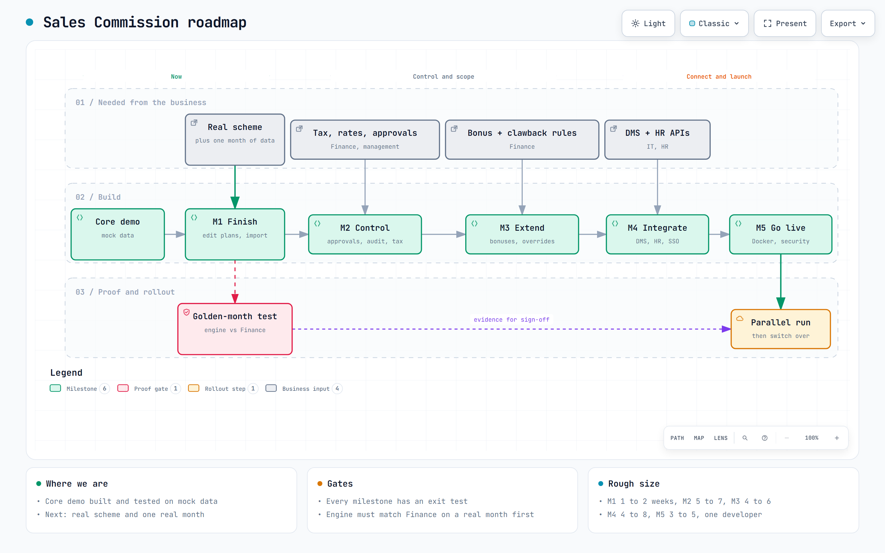
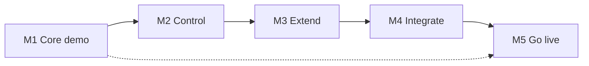
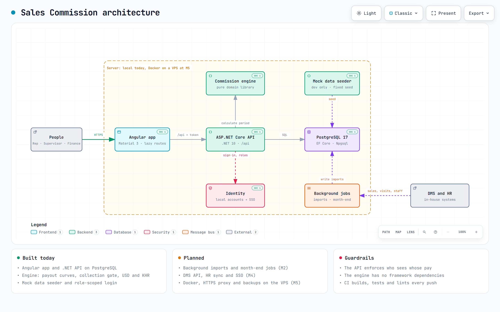
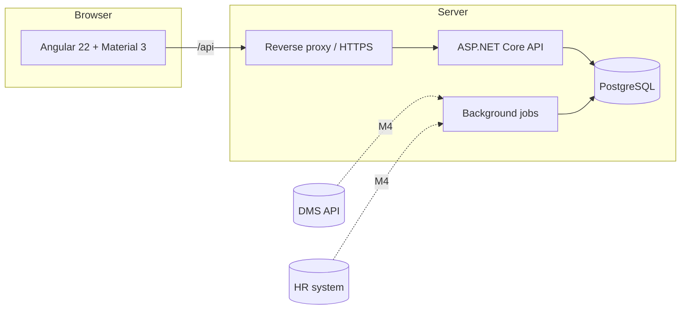

# Sales Commission: master plan

Status: **draft for review** · Owner: project lead · Last updated: 2026-10-22
Related: [scoping decisions](01-plan-and-scoping.md) · [UI foundation](02-ui-foundation.md) · [README](../README.md)

---

## 1. Purpose

Hanuman Beverages pays its outdoor sales staff a variable commission. Today it is worked out
by hand from spreadsheets. This is slow, hard to audit, and invisible to the people being paid.

**Sales Commission** is a web system that calculates commission from sales activity using
configurable plans, lets the right people review and approve it, and shows each salesperson exactly how
their payout was reached.

### Outcomes

| # | Outcome | How we will know |
|---|---------|------------------|
| 1 | Commission is calculated by the system, not by hand | A full month runs in minutes and matches Finance's manual figure to the cent in the parallel run |
| 2 | Every payout can be explained | Any line traces to its KPI, target, plan version and source transactions |
| 3 | Reps trust and understand their pay | Reps can see their own progress on a phone; disputes fall in number after two cycles |
| 4 | Plans change without a developer | Finance creates and versions a plan using the UI, with no code change |
| 5 | Money is controlled | Approved periods are locked, every change is logged, and payout files come from the system |

### Non-goals (for now)

Payroll execution, general-ledger posting to the ERP, a native mobile app, HR administration, and
replacing the DMS. We integrate with those systems; we do not rebuild them.

---

## 2. Users and stakeholders

| Role | What they need | Access |
|------|----------------|--------|
| **Sales rep** (pre-sales, van, key account, merchandiser) | See my commission and why; raise a dispute | Own data only, mobile-first |
| **Supervisor** | See and approve my team's results | Own team |
| **Manager** | Review a region; approve | Own region |
| **Finance** | Maintain plans and targets, run and lock periods, produce payouts and accruals | Everything |
| **Admin** | Users, master data, configuration | Everything |
| **Management** | Totals and trends | Read-only |
| **Internal audit** | Prove how a number was reached | Read-only, audit trail |

Scale: 200 to 500 field staff, 4 regions today, monthly cycle plus quarterly and annual bonuses.

---

## 3. Scope by milestone

The demo came first, with mock data, so the business could judge the idea before integration work.

Interactive version (pan, zoom, trace a path, export): open [diagrams/roadmap.html](diagrams/roadmap.html)
in a browser after cloning or downloading the repository. The source is `diagrams/roadmap.json`.

Changes from the split in [01-plan-and-scoping.md](01-plan-and-scoping.md): file import moves from M3 to M1,
because testing the engine against a real month is the biggest risk reducer; clawbacks and reports are
named explicitly in M3; hosting, security hardening and the parallel run become their own milestone (M5).

### M1: Core demo (mostly done)

Mock data, plans and targets, monthly calculation, rep mobile view, role-based access.

| Item | Status |
|------|--------|
| Domain model, calculation engine (payout curves, collection gate, USD/KHR, plan selection) | Done, 29 tests |
| Mock data generator, PostgreSQL schema, JWT login with roles | Done |
| Dashboard, results, result breakdown, plans, employees, rep view | Done |
| UI foundation: Material 3 theme, shell, shared components, CI | Done |
| **Edit** plans, targets and employees in the UI | **To do** |
| Unique mock names; target and curve tuning with real figures | To do |
| Excel/CSV import of sales, returns, collections, visits | To do |

**Exit:** Finance can build a plan and targets without a developer, and load a real month from files.

### M2: Control

The features that make the numbers trustworthy and payable.

- Period lifecycle: Open → Calculated → In review → Approved → Locked, with reopen needing Admin plus a reason
- Configurable approval steps per plan (for example Supervisor → Manager → Finance)
- Audit log of every change: who, when, before, after
- Adjustments (manual add/deduct with a reason) and rep disputes with a resolution workflow
- Salary tax as a configurable bracket table; statements show gross, tax, net
- PDF commission statements per person
- Payout export to Excel/CSV for payroll

**Exit:** a month can be calculated, reviewed, disputed, corrected, approved, locked and paid out with a
complete trail.

### M3: Extend

- Quarterly and annual bonuses reading aggregated monthly results
- Supervisor and manager commission rolled up from team results
- Accrual list per period (by region and cost centre) with Excel export
- Clawbacks for returns, expiry and bad debt after the period closes
- Reports: payout by region/plan/period, trends, exceptions

**Exit:** all plan types in use at Hanuman can be modelled and run.

### M4: Integrate

- **DMS connector:** replace file import with the in-house DMS API (sales, returns, collections, visits,
  audits), with reconciliation and an import log
- **HR sync:** employees and hierarchy from the HR system
- **Single sign-on** with the company identity provider, if available

**Exit:** no manual data entry for master or transaction data.

### M5: Go live

- Docker packaging, reverse proxy and HTTPS on the VPS, backups and restore test
- Security hardening and review (section 8)
- Parallel run for one to two months against the current spreadsheet process
- Rep and Finance training; support routine; rollback plan

**Exit:** Finance signs off the parallel run and switches over.

### Later

Khmer UI and Khmer-safe PDFs, what-if simulator for plan design, accrual posting to the ERP,
leaderboards, native/offline mobile app, forecasting.

---

## 4. Architecture

Interactive version: [diagrams/architecture.html](diagrams/architecture.html). Each built component links to its
source file. The source is `diagrams/architecture.json`. Dashed lines and "planned" tags are not built yet.

Simplified view, which also renders directly on GitHub:

| Layer | Choice | Notes |
|-------|--------|-------|
| Frontend | Angular 22, standalone, signals, Angular Material 3 | Lazy routes, light/dark, mobile-first rep view |
| API | ASP.NET Core on .NET 10 (LTS) | Controllers, JWT auth, role-scoped queries |
| Domain | Plain C# library with no framework dependencies | The calculation engine is pure and unit-tested |
| Data | PostgreSQL via EF Core | Money as `decimal`, effective-dated plan versions |
| Jobs | Hangfire or Quartz (M2) | Nightly import, month-end calculation |
| Hosting | Local now; Docker on a VPS at M5 | Relative `/api` already in place |

**Key design rules**

1. Plan rules are data, not code. A new plan type needs a rule type in the engine once, then Finance configures it.
2. The calculation is repeatable: the same inputs and plan version always give the same result.
3. Plans are versioned by effective date, so a past month always recalculates under its own rules.
4. Every result line stores its KPI, target, achievement and payout for explanation and audit.
5. Reads are scoped on the server by role. The UI hides things for convenience, but the API enforces access.
6. Money is stored in its original currency with the period's exchange rate; rounding rules are explicit per currency.

---

## 5. Data and integration plan

| Data | Source now | Source at M4 | Owner to confirm |
|------|-----------|--------------|------------------|
| Employees and hierarchy | Mock / manual entry | HR system | HR |
| Outlets, products | Mock | DMS | Sales Ops |
| Invoices, returns, collections | Mock / file import | DMS API | Sales Ops, IT |
| Visits, audits | Mock / file import | DMS API | Sales Ops, IT |
| Exchange rates | Per period, entered | Same, with a named source | Finance |
| Targets | Entered | Entered or imported | Sales Ops |

Import rules: every import is logged, idempotent (re-running does not double count), and reconciled
against control totals before it can feed a calculation.

---

## 6. Quality strategy

| Concern | Approach |
|---------|----------|
| Calculation correctness | Unit tests per rule; **golden-month tests** built from a real period and Finance's own result |
| API | Integration tests against a real PostgreSQL for access scoping, calculation runs and imports |
| UI | Component and service tests; accessibility checks (keyboard, contrast, labels); phone-width review of every screen |
| Regression | CI on every push and pull request: build with warnings as errors, tests, lint, format check, bundle budgets |
| Acceptance | Parallel run: system versus spreadsheet, differences explained line by line |

Definition of done for a feature: works on phone and desktop, has loading/empty/error states, enforced
by role on the server, covered by tests, CI green, documented where users or operators would look.

---

## 7. Deployment and operations (M5)

- Containers: API, frontend (static, served by the proxy), PostgreSQL with a persistent volume.
- Configuration and secrets from environment variables or an untracked `.env`; none in git.
- HTTPS and certificates through a reverse proxy; HTTP to HTTPS redirect.
- Database: migrations applied as an explicit deploy step; nightly `pg_dump` backup kept off the server; a restore tested before go-live.
- Logging with request IDs, health endpoint, and an alert if a scheduled job fails.
- First admin created by a one-time command; the demo seeder never runs outside Development.

---

## 8. Security and compliance

| Area | Plan |
|------|------|
| Authentication | Local accounts now (hashed, lockout after repeated failures); SSO at M4 |
| Authorisation | Role and scope checks in the API on every endpoint; tests that a rep cannot read another rep |
| Sensitive data | Pay data is personal and confidential: least-privilege access, HTTPS only, no pay data in logs |
| Secrets | Replace all dev placeholders (database password, signing key, demo accounts) before any real deployment |
| Audit | Immutable log of approvals, adjustments, plan changes and reopen events |
| Privacy | Confirm retention period and who may see whose data with HR/legal before go-live |
| Repository | Currently public; make private before real figures or rules are added |

---

## 9. Risks

| Risk | Likelihood | Impact | Mitigation |
|------|-----------|--------|-----------|
| The real commission scheme is more complex than the model | High | High | Get one real month plus the scheme document now; build golden tests from it before M2 |
| DMS data quality or API gaps | Medium | High | File import first; reconciliation reports; agree the API contract with the DMS team early |
| Plan rules change often | High | Medium | Plans as versioned data; rule types added in the engine only when truly new |
| Disagreement over a payout erodes trust | Medium | High | Full breakdown per result, dispute workflow, parallel run before switch-over |
| Salary tax rules misapplied | Medium | High | Configurable brackets, signed off by Finance; no tax logic hard-coded |
| Exchange-rate source disputed | Medium | Medium | One named rate per period, shown on every statement |
| Single developer plus AI assistant | High | Medium | Small vertical slices, strong automated tests, documentation in the repo |
| Scope creep from "just one more KPI" | High | Medium | New KPI types go through the backlog; milestones have exit criteria |
| Hosting or data-protection surprises late | Medium | Medium | Decide hosting and retention before M4; deploy to a staging VPS early |

---

## 10. Open decisions

| # | Decision | Needed by | Who |
|---|----------|-----------|-----|
| 1 | The real commission scheme and one anonymised month of actual data | Before M1 exit | Sales Ops, Finance |
| 2 | Salary-tax brackets and how they apply to commission | Before M2 | Finance |
| 3 | Exchange-rate source and who sets the monthly rate | Before M2 | Finance |
| 4 | Approval chain per plan | Before M2 | Management |
| 5 | Sales base per plan: invoiced, net of returns, or collected | Before M1 exit | Finance |
| 6 | Clawback rules (returns, expiry, bad debt after close) | Before M3 | Finance |
| 7 | DMS API contract and a test environment | Before M4 | IT |
| 8 | HR system, and how employees are identified | Before M4 | HR, IT |
| 9 | Single sign-on provider, if any | Before M4 | IT |
| 10 | Hosting: which VPS, backup target, domain | Before M5 | Project lead |
| 11 | Data retention and privacy rules for pay data | Before go-live | HR, legal |
| 12 | Budget for hosting and any licences | Before M5 | Management |
| 13 | Target go-live date and parallel-run window | After M2 | Management |

---

## 11. How we work

- Trunk-based on `main` with short-lived branches and pull requests once more than one person contributes. CI must be green to merge.
- Small vertical slices, each shippable and demonstrated. A milestone is done when its exit criteria are met, not when the list is empty.
- Decisions are recorded in `docs/` and referenced from the code or backlog item that depends on them.
- A demo to Finance and Sales Ops at the end of each milestone, with their feedback captured before the next begins.
- Dependencies and framework versions are updated on a regular cadence, not only when something breaks.

### Effort guide

Rough sizes for one developer working with an AI assistant. These are estimates to plan around, not commitments.

| Milestone | Size | Main uncertainty |
|-----------|------|------------------|
| Finish M1 | 1 to 2 weeks | Real scheme versus the mock one |
| M2 Control | 5 to 7 weeks | Approvals, tax rules, PDF statements |
| M3 Extend | 4 to 6 weeks | Bonus and override rules |
| M4 Integrate | 4 to 8 weeks | DMS and HR API readiness |
| M5 Go live | 3 to 5 weeks plus the parallel run | Hosting, security review, UAT |

---

## 12. Next steps

1. Collect the real scheme and one anonymised month of data (open decision 1).
2. Finish M1: plan, target and employee editing, and file import.
3. Build golden-month tests from the real month, then fix the engine until it matches Finance.
4. Make the repository private.
5. Confirm tax, exchange-rate and approval decisions, then start M2.
